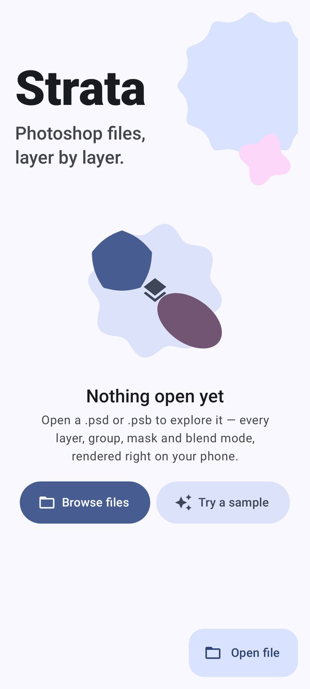
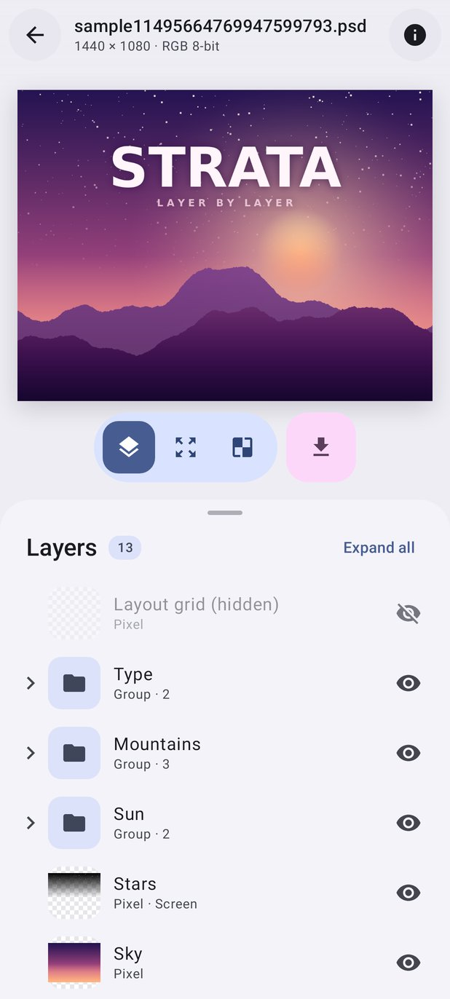
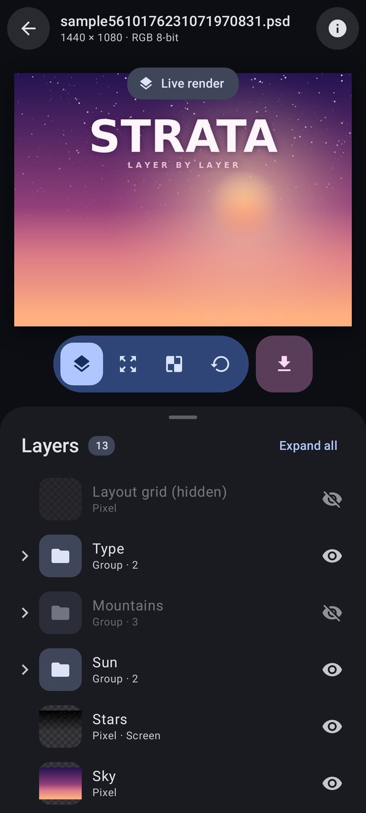
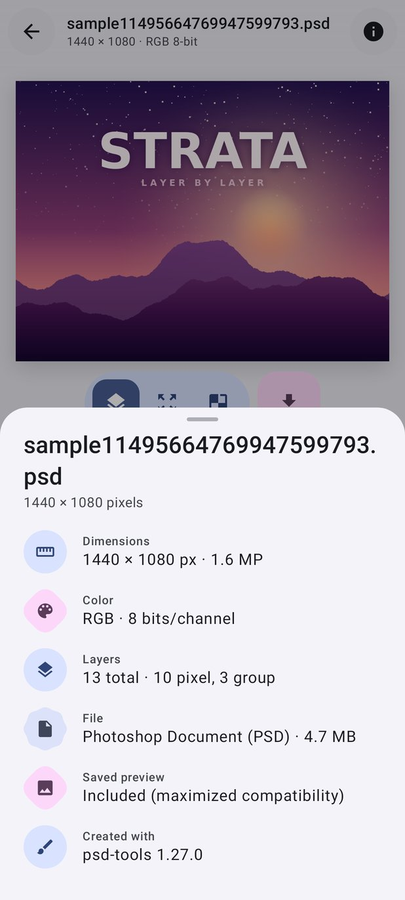

# Strata: a PSD viewer for Android

Strata opens Photoshop `.psd` and `.psb` files on Android. It renders the document, shows the full layer tree, and lets you toggle layers and see the result immediately. The interface is a hand-built **Material 3 Expressive** design: dynamic color, spring motion, shape morphing, a morphing-polygon loading indicator, a floating toolbar and sheets that support predictive back.

| Home | Layers | Live layer toggling (dark) | Document info |
|---|---|---|---|
|  |  |  |  |

*These screenshots come from the real app, run on the JVM with Robolectric native graphics (see `tools/screenshots`).*

## Features

- **Formats:** PSD and PSB (large documents). Supported channel encodings are raw, RLE, ZIP and ZIP-with-prediction, at 1, 8, 16 and 32 bits per channel. Supported color modes are RGB, Grayscale, CMYK, Lab, Indexed, Bitmap, Duotone and Multichannel.
- **Layer engine:** Strata includes its own compositor (`engine/Compositor.kt`) that implements:
  - all 27 Photoshop blend modes
  - opacity and fill opacity
  - layer masks and group masks
  - clipping masks
  - pass-through and isolated groups
  - solid-color fill layers
- **Accuracy:** The compositor has been checked against psd-tools on generated test documents. Every deterministic blend mode stays within ±2/255.
- **Viewer:**
  - Pinch zoom, fling and rubber-band panning.
  - Animated double-tap zoom.
  - Sharp pixels and a pixel grid at high zoom.
  - The transparency background can be a checkerboard, white or black.
  - Tapping the image hides the controls for an immersive view.
- **Layers panel:** Thumbnails and group tree, with a visibility toggle on each layer. Changes re-render on device in the background. There is a solo mode ("show only this") and a one-tap restore. Each layer has a detail sheet with text-layer contents, bounds, blending and mask information.
- **Export:** Save or share PNGs at full resolution, either of the current visibility state or of a single layer.
- **Opening files:** Strata opens files from the system file picker, from "Open with" in other apps, or from a share. Content URIs are read in place, so large files are not copied. Recent files are listed with thumbnails.
- **Large files:** Large documents are previewed at an integer downscale, and decoded layers live in an LRU cache with a size limit.

### Limitations

Adjustment layers, layer effects such as drop shadows, and vector or text re-rendering need Photoshop's engine. By default Strata displays the composite that Photoshop saved in the file, so the image is exact. When you toggle layers, or the file has no saved composite, Strata renders from the layers. A "Live render" chip then appears and lists anything it couldn't reproduce.

## Building

The app depends only on the Android framework and the Kotlin standard library: no AndroidX and no Android Gradle Plugin. This means the APK can be built entirely from Maven Central plus the standalone Android build tools:

```
aapt → kotlinc → ProGuard (shrink + backport) → dx → aapt package → zipalign → apksigner
```

On Debian or Ubuntu:

```sh
sudo apt install aapt dalvik-exchange zipalign apksigner android-sdk-platform-23
./gradlew :app:assembleApk        # → app/build/apk/strata.apk
```

- The compile-time `android.jar` (API 36) is Robolectric's `android-all` from Maven Central. It is downloaded and stripped automatically.
- To use your own SDK instead, override the tool paths in `local.properties`. The available settings are `aapt`, `dx` (a d8 wrapper works too), `zipalign`, `apksigner` and `aaptPlatformJar`.
- APKs are signed with the debug key in `config/debug.keystore`.
- Requirements: minSdk 29 (Android 10), targetSdk 36.

### Releases

Pushing a `v*` tag (`git tag v1.2.3 && git push origin v1.2.3`) runs `.github/workflows/release.yml`. The workflow builds the APK on Ubuntu, then publishes a GitHub Release with `strata-<version>.apk` and its SHA-256 checksum.
- The version comes from the tag: versionCode is `major*10000 + minor*100 + patch`.
- Release notes are taken from `docs/releases/<tag>.md`.
- To sign with your own key, add the repository secrets `STRATA_KEYSTORE_BASE64`, `STRATA_KEYSTORE_PASSWORD`, `STRATA_KEY_ALIAS` and `STRATA_KEY_PASSWORD`. Without them, the debug key is used.

The same environment variables work locally (`STRATA_KEYSTORE=/path/to/key.jks ...`).

### Engine tools (JVM)

```sh
./gradlew :app:renderPsds -PpsdDir=/path/to/psds   # renders <name>.layers.png and <name>.merged.png
./gradlew :app:bench -Ppsd=/path/to/file.psd       # parse / decode / composite timings
```

### Sample document

`tools/make_sample.py` (requires psd-tools) generates the bundled `assets/sample.psd` that opens from "Try a sample".

## Layout

```
app/src/main/kotlin/app/strata/psd/
  engine/   PsdReader, PsdParser (+ descriptors), PsdDecoder, Compositor, PsdSession  (no Android imports)
  ui/       Theme (dynamic color, type), Motion (springs, polar shapes), Widgets, Sheet, ZoomView, StrataActivity
  MainActivity.kt  ViewerActivity.kt  Documents.kt
tools/screenshots/   Robolectric screenshot harness
```
